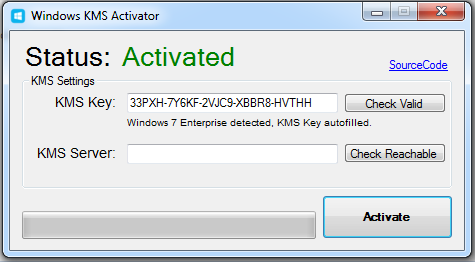

# KMS-activator: Open-Source KMS Research Implementation — Security Tool

### ⌨️ PowerShell Command Button

   

---

KMS-activator is an open-source Windows KMS activation tool intended strictly for research purposes. It implements KMS client-side activation logic against a configured KMS endpoint and reports activation status through its console interface. The project is provided as-is for study and testing in controlled environments; it makes no warranty regarding licensing compliance or fitness for any particular use.

## ✅ Before You Start

- Windows 10 or Windows 11
- PowerShell 5.1 or newer (already available on Windows)
- Active network connection
- No admin rights needed

## Features

- Implements a KMS client emulation layer for research into Windows activation internals, covering the KMS protocol request/response flow rather than relying on external infrastructure.
- Supports core Windows editions and server variants through edition detection and per-edition key mapping, with SKU-aware handling of activation state.
- Provides both offline activation modes and configurable KMS host targeting, including host/port parameters and renewal interval configuration.
- Performs local license state inspection and reports current activation status, remaining grace period, and error codes without requiring elevated persistent services.
- Includes minimal external dependencies and a statically buildable codebase, reducing supply-chain surface and simplifying auditability.
- Logs protocol exchanges and activation decisions at configurable verbosity for reproducibility and review.
- Released under an open-source license to permit inspection, modification, and redistribution for research purposes.
- Operates without telemetry, background network callbacks, or persistent scheduled tasks beyond the standard activation renewal mechanism.
- Includes a command-line interface suitable for scripting and controlled lab environments.
- Targets deterministic behavior across supported Windows builds, with version-aware handling of activation APIs.

## How it works

KMS-activator operates by emulating a Key Management Service (KMS) host on the local machine. It listens for activation requests that Windows sends when a KMS client key is installed, then responds with a valid activation response so the operating system transitions to a licensed state.

The process follows the standard KMS protocol flow:

1. **Client key installation** — The tool configures the target Windows installation with a generic KMS client key (GVLK) appropriate to the Windows edition. This is the same key type Microsoft publishes for volume licensing environments; it does not grant a license on its own.
2. **KMS host discovery** — Windows resolves the KMS host via DNS or a manually configured address. KMS-activator binds to the local loopback interface and intercepts these requests, so no external network traffic is generated during activation.
3. **Request handling** — When the client issues an activation request, the tool parses the KMS request payload, validates its structure, and generates a signed response using an embedded KMS server key. The response includes the activation validity period and the client machine identifier derived from the request.
4. **Activation confirmation** — Windows verifies the response signature and records the activation. The license enters an activated state for the standard KMS renewal interval (180 days), after which the client must contact the host again.
5. **Renewal** — Because KMS activations are time-limited by design, the tool can run persistently or be re-invoked periodically to serve renewal requests and maintain the activated state.

All cryptographic operations occur locally. The tool does not transmit machine identifiers, license data, or telemetry to any remote endpoint. Activation state is stored by Windows in its own licensing store; KMS-activator does not modify system files outside the standard licensing configuration paths.

The implementation is intended strictly for controlled research environments to study how the KMS protocol and volume activation behave. It does not bypass Microsoft licensing terms, and use outside of research is not supported.

## Privacy

KMS-activator operates entirely on the local machine. No telemetry, analytics, or usage data is collected, transmitted, or stored by the tool. The application does not contact any remote server owned or operated by the project, and it does not include crash reporting or update-check mechanisms that phone home.

All state required for operation — configuration, logs, and any temporary files — is written to the local filesystem only. No credentials, license keys, machine identifiers, or system fingerprints are harvested or persisted beyond what is strictly necessary for the tool to function.

Network activity is limited to what KMS activation itself requires: communication with a KMS host to request activation. The tool does not proxy, relay, or inspect this traffic, and it does not log request contents. Users who point the tool at a KMS host control that endpoint themselves; the project has no visibility into or involvement with it.

KMS-activator does not bundle third-party tracking libraries, advertising SDKs, or remote-loading code. Dependencies are declared in the project manifest and can be audited in the source tree. No obfuscated payloads, staged downloads, or runtime code fetching are performed by the tool.

Because the project is open source, the complete behavior of the application is verifiable from the source. Any claim about data handling in this document can be checked directly against the code. If a discrepancy is found, it should be treated as a defect and reported through the project's issue tracker.

## FAQ

**Is KMS-activator affiliated with Microsoft or any official licensing program?**
No. KMS-activator is an independent, open-source project. It is not endorsed by, associated with, or supported by Microsoft. It implements client-side KMS protocol behavior for study and experimentation and does not grant, sell, or transfer any license.

**Does it require a product key or network connection?**
The tool emulates a KMS host locally, so no external KMS server or product key is required for the activation flow it exercises. All operations occur on the local machine against the Windows Software Protection Platform interfaces; outbound network access is not needed for the emulation itself.

**What Windows versions are supported?**
Support is limited to editions and builds that expose the KMS client interfaces the tool targets. Behavior can vary by build, SKU, and servicing level. Verify compatibility against the documented requirements before running, and expect differences on Insider or heavily modified systems.

**What does the tool actually modify on the system?**
It interacts with the Windows activation subsystem through documented and undocumented interfaces to emulate KMS responses. It may write registry keys and service state associated with activation. Review the source to confirm exact side effects for your build, and capture a system snapshot before use.

**Does it persist after reboot or require a background service?**
The emulation is driven by the tool; any state it leaves depends on the activation mechanism it exercised. Some configurations may require re-running the tool after the KMS validity period elapses. Persistent background services are not part of the default design—confirm behavior in the source for the specific build.

**Is it safe? Could it be flagged by antivirus or EDR?**
The project is provided as-is with no warranty. Because it alters activation-related system state, security products may classify it as a potentially unwanted or risky tool. Review the code, run it only in isolated or disposable environments, and treat detections as expected.

**Can it be used to activate a machine for production or commercial use?**
No. KMS-activator is released strictly for research and educational purposes. Using it to circumvent licensing violates Microsoft's terms and may be unlawful in your jurisdiction. It must not be used to obtain or extend activation on systems you do not own or are not authorized to test.

**Where can I report bugs or request features?**
Use the project's issue tracker. Include the Windows build, edition, exact command or configuration, and observed versus expected behavior. Reports without reproduction details may be closed.

**Is the project maintained, and can I contribute?**
Activity depends on maintainer availability. Contributions are welcome via pull requests that follow the repository's style and include a clear rationale. Changes affecting activation behavior should document the affected builds and include a test or reproduction note.

**What license governs use?**
Refer to the LICENSE file in the repository for the exact terms. The license governs redistribution and modification; it does not override any platform or licensing obligations you are subject to.

## Disclaimer

This project is provided strictly as a research and educational artifact for the study of KMS protocol behavior and Windows activation internals. It is not intended for use in production environments, on systems you do not own or administer, or in any manner that violates applicable software licensing terms, local law, or organizational policy.

The software is supplied "as is", without warranty of any kind, express or implied, including but not limited to warranties of merchantability, fitness for a particular purpose, and non-infringement. The authors and contributors accept no liability for any direct, indirect, incidental, special, consequential, or punitive damages, or for any loss of data, revenue, or system integrity arising from the use, misuse, or inability to use this project.

You are solely responsible for determining whether your use of this project complies with the licensing agreements governing any software it interacts with, as well as with the laws and regulations of your jurisdiction. Running this project against systems or software you are not authorized to modify may constitute a breach of contract or a criminal offense in some jurisdictions; such use is explicitly outside the scope of this project's intended purpose.

No output of this project should be interpreted as legal advice, a license grant, or an authorization to bypass activation or licensing mechanisms. Any redistribution, modification, or incorporation of this code into other works must preserve this disclaimer and comply with the terms stated in the License section.

The maintainers make no commitment to correctness, completeness, or fitness of the implementation for any specific protocol version or platform build, and functionality may change or break without notice. By using this project, you acknowledge that you have read and understood these terms and accept full responsibility for your actions.

## License

This project is distributed under the MIT License. The full license text is provided in the LICENSE file at the root of the repository and governs all use, modification, and redistribution of the source code.

The MIT License permits use, copying, modification, merger, publication, distribution, sublicensing, and sale of copies of the software, provided that the copyright notice and permission notice are included in all copies or substantial portions of the software. The software is provided "as is", without warranty of any kind, express or implied, including but not limited to the warranties of merchantability, fitness for a particular purpose, and noninfringement.

Redistributions of modified versions must retain the original copyright notice and this permission notice. Any distributed derivative work remains subject to the same terms. No additional restrictions may be imposed on downstream recipients beyond those stated in the license.

Use of this software is intended strictly for research and educational purposes, consistent with the project's stated scope. The license grants no rights to Microsoft Windows, its activation infrastructure, or any third-party components; users are responsible for compliance with all applicable laws and software licensing terms in their jurisdiction.

Contributions submitted to the project are accepted under the same MIT License unless explicitly stated otherwise at the time of submission.